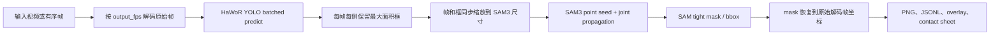

# Hand Detection + SAM3 Mask

这是一个可独立交接的 **手部 detection → SAM3 mask** repo，不依赖完整 HaWoR
pipeline 的 SLAM、MANO、OSS scheduler 或数据集代码。

T-cluster 已发布版本的固定入口是：

```text
/mnt/hwfile/share_data/songkaiwen/hand_detection_sam3_mask
```

该目录同时包含 Git 历史、detector checkpoint、SAM3 checkpoint/config 和
`third_party/sam3` 源码，不需要再从 Hugging Face 或 GitHub 下载模型文件。

当前提取基线来自 HaWoR commit
`579253db1787b306161e81444170178cd6628e37`，具体函数对应关系见
[`docs/SOURCE_MAP.md`](docs/SOURCE_MAP.md)。

## 1. 当前算法



`configs/default.yaml` 对齐 2026-07-16 实时核对的
`egocentric10k_t_8gpu_gated_production.sbatch` 推理路径：

- detector：Ultralytics YOLO `predict`，不是 `track`；
- detection confidence：`0.2`；
- detect-once prepass batch：`16`；
- 同一帧同一侧存在多个框时，保留 **面积最大** 的框，不是置信度最大框；
- side：`0=left`，`1=right`；
- SAM3 seed threshold：`0.75`；
- seed window：`5 s`；
- tracking：`joint`；
- init：`point`；
- prompt geometry：`box_below`；
- propagation：`single_anchor`；
- mask archive：`npz`；
- bbox-only ego gate：默认开启，完整阈值见
  [`docs/PRODUCTION_DEFAULTS.md`](docs/PRODUCTION_DEFAULTS.md)；
- SAM3 输入最长边：`1008`；
- 最终 mask、bbox 和 `overlay.mp4`：恢复到原始解码帧分辨率和坐标。

这个 repo 只做 detection 和 mask，不生成 HaWoR 的 SLAM/MANO 结果。

## 2. 目录结构

```text
hand_detection_sam3_mask/
  configs/default.yaml                  # 所有运行参数，flat YAML
  weights/detector.pt                   # 共享发布版内置，不进入 Git
  checkpoints/facebook_sam3/            # sam3.pt + config.json，共享发布版内置
  third_party/sam3/                     # 固定 SAM3 源码，共享发布版内置
  src/hand_detection_sam3_mask/
    detection.py                        # YOLO batched predict
    detection_payload.py                # bboxes_2d.pth schema
    sam3_point.py                        # 当前 production point-prompt 核心
    sam3_helpers.py                      # SAM3 helper surface
    sam3_input.py                        # 帧/框同步 resize
    postprocess.py                       # mask 恢复原始坐标
    visualization.py                    # 原始帧 overlay/contact sheet
    pipeline.py                          # end-to-end orchestration
  scripts/
    setup_env.sh                         # 建环境并安装 SAM3
    download_models.sh                   # 下载 detector + SAM3 权重
    run_video.sh                         # 视频一键运行
    run_frames.sh                        # 图片目录一键运行
    visualize.sh                         # 只重画可视化
    check.sh                             # 模型无关验收
    package_repo.sh                      # 生成纯代码交接包
    create_publish_bundle.sh             # 生成可保留 Git 历史的发布 bundle
  slurm/run_hand_sam3_mask.sbatch        # 单 GPU Slurm 入口
  slurm/publish_to_hwfile.sbatch          # compute-node HWFILE 发布入口
  tests/                                 # 不需要模型/GPU的单测
  PUBLICATION_MANIFEST.json              # 发布 job/commit/checkpoint 指纹
  CHECKSUMS.sha256                       # 共享发布版完整性校验
```

## 3. 环境要求

- Linux；
- Python `>=3.12`；
- CUDA GPU；
- SAM3 对应的 PyTorch/CUDA runtime；
- 已获批并可下载 `facebook/sam3` checkpoint。

共享发布版默认使用内置 `third_party/sam3`。安装脚本使用 PyTorch `2.10.0` +
CUDA 12.8 wheel：

```bash
cd /mnt/hwfile/share_data/songkaiwen/hand_detection_sam3_mask
bash scripts/setup_env.sh
```

自定义 Python 或 PyTorch wheel index：

```bash
PYTHON_BIN=python3.12 \
TORCH_INDEX_URL=https://download.pytorch.org/whl/cu128 \
bash scripts/setup_env.sh
```

如果拿到的是不含 `third_party/sam3` 的纯代码 tar，而不是 HWFILE 共享发布版，
需要显式选择联网 clone：

```bash
SAM3_SOURCE_MODE=clone SAM3_GIT_REF=main bash scripts/setup_env.sh
```

如果已有集群容器/venv，可以跳过建环境，只执行：

```bash
pip install -e /path/to/sam3
pip install -e '.[dev]'
```

## 4. 模型文件

共享发布版已经包含：

```text
weights/detector.pt
checkpoints/facebook_sam3/sam3.pt
checkpoints/facebook_sam3/config.json
```

具体字节数、SHA-256、代码 commit 和生产脚本指纹见
`PUBLICATION_MANIFEST.json` 和 `CHECKSUMS.sha256`。大文件完整哈希应在 Slurm
compute node 上校验，不要在管理节点进行高 I/O 校验。

只有纯代码 checkout 才需要下载模型。先在 Hugging Face 申请
`facebook/sam3` 权限并完成登录：

```bash
source .venv/bin/activate
hf auth login
bash scripts/download_models.sh
```

默认写入：

```text
weights/detector.pt
checkpoints/facebook_sam3/sam3.pt
checkpoints/facebook_sam3/config.json
```

权重、token 和下载缓存都不会进入 Git。

## 5. 一键运行视频

```bash
bash scripts/run_video.sh \
  /path/to/input.mp4 \
  /path/to/outputs/input_run
```

先跑 120 帧 smoke：

```bash
bash scripts/run_video.sh \
  /path/to/input.mp4 \
  /path/to/outputs/input_smoke \
  --max-frames 120
```

覆盖已有输出必须显式传：

```bash
bash scripts/run_video.sh INPUT.mp4 OUTPUT_DIR --overwrite
```

完整 CLI 等价写法：

```bash
python -m hand_detection_sam3_mask video \
  --config configs/default.yaml \
  --video /path/to/input.mp4 \
  --output-dir /path/to/output \
  --detector-weight weights/detector.pt \
  --sam3-checkpoint checkpoints/facebook_sam3/sam3.pt \
  --sam3-src third_party/sam3 \
  --device cuda
```

## 6. 运行图片目录

输入目录按文件名排序，支持 `.jpg/.jpeg/.png/.bmp/.webp`：

```bash
bash scripts/run_frames.sh \
  /path/to/ordered_frames \
  /path/to/outputs/frames_run
```

图片必须具有相同分辨率。`configs/default.yaml` 中的 `output_fps` 用于
SAM3 window 和输出视频帧率。

## 7. 修改配置

不要直接改 Python 常量。复制一份 flat YAML 后做 sweep/ablation：

```bash
cp configs/default.yaml configs/my_run.yaml
python -m hand_detection_sam3_mask video \
  --config configs/my_run.yaml \
  --video INPUT.mp4 \
  --output-dir OUTPUT_DIR \
  --detector-weight weights/detector.pt \
  --sam3-checkpoint checkpoints/facebook_sam3/sam3.pt
```

常用配置：

| key | 默认值 | 含义 |
|---|---:|---|
| `output_fps` | `10.0` | 视频采样和结果 FPS |
| `detector_confidence` | `0.2` | YOLO detector threshold |
| `detector_batch_size` | `16` | production detect-once prepass batch |
| `sam3_input_max_side` | `1008` | SAM3 输入最长边 |
| `sam3_score_thresh` | `0.75` | detection seed threshold |
| `sam3_window_sec` | `5.0` | prompt seed window |
| `sam3_tracking_mode` | `joint` | 左右手共享 session |
| `sam3_prompt_geometry` | `box_below` | positive/negative point geometry |
| `sam3_propagation_scheme` | `single_anchor` | propagation scheme |
| `sam3_mask_archive` | `npz` | production archive；最终仍恢复成 PNG |
| `sam3_ego_gate_enabled` | `true` | production bbox-only ego-hand gate |
| `write_visualization` | `true` | 是否生成 overlay/contact sheet |
| `wandb_mode` | `offline` | 默认离线记录完整 config |

每次运行会把完整 config、独立 repo commit、SAM3 repo commit 和来源 HaWoR
commit 写入 `run_config.json`，并记录到 offline wandb run。

生产 scheduler 设置 `WANDB_MODE=disabled`，而本交接 repo 有意保留
`wandb_mode=offline` 和 `write_visualization=true`，用于本地记录完整 config 与
视觉 QA；这两个是交接审计项，不改变 detector/SAM3 推理参数。若复现未开启
ego gate 的 Ego4D 路径，复制 config 后只把 `sam3_ego_gate_enabled` 改为
`false`，不要修改默认文件。

## 8. 输出格式

```text
OUTPUT_DIR/
  run_config.json
  frame_manifest.json
  summary.json
  frames/                              # 原始解码帧坐标
    000000.jpg
  detection/
    bboxes_2d.pth                      # 原始解码帧坐标
  detections.jsonl
  sam3_input/                          # 只供 SAM3 使用的 resize 中间件
    resize_meta.json
    frames/
    detection/bboxes_2d.pth
  sam3_raw/                            # SAM3 原生结果/诊断
    point_prompt_summary.json
    prompt_seed_debug.json
    sam_tight_bboxes_2d.jsonl
    framewise_masks/ 或 archive
  masks/                               # 恢复到原始解码帧分辨率
    left/000000.png
    right/000000.png
  masks.jsonl
  mask_summary.json
  overlay.mp4                          # 在原始解码帧上绘制
  contact_sheet.jpg                    # 先画原图，再缩略排版
  visualization_summary.json
  wandb/                               # offline run
```

### `detection/bboxes_2d.pth`

主要 tensor：

- `frame_idx`: `(N,)`；
- `boxes_xyxy`: `(N, 4)`，绝对像素 `xyxy`；
- `scores`: `(N,)`；
- `handedness`: `(N,)`，`0=left, 1=right`；
- `track_id`: semantic side alias，当前为 `0/1`，不是 detector tracker ID；
- `image_size_hw`: 原始解码帧 `(H, W)`。

### mask 约定

- PNG 是单通道二值图：前景 `255`，背景 `0`；
- 每帧始终输出 left/right 两张 PNG；缺失/空 mask 是全零图；
- `masks.jsonl` 的 `status` 为 `ok` 或 `empty_mask`；
- 坐标与 `frames/` 完全一致。

### 可视化颜色

- 左手：蓝色；
- 右手：红色；
- bbox 和 mask 采用相同左右手颜色；
- overlay 先画在原始解码帧上，contact sheet 只在画完后缩放。

## 9. 单独重画可视化

mask 已生成时，不需要重新跑模型：

```bash
bash scripts/visualize.sh /path/to/OUTPUT_DIR
```

## 10. Slurm 运行

不要手动设置 `CUDA_VISIBLE_DEVICES`，由 Slurm 分配 GPU。

```bash
cd /mnt/hwfile/share_data/songkaiwen/hand_detection_sam3_mask
mkdir -p logs outputs

PROJECT_DIR=$PWD \
INPUT_TYPE=video \
INPUT_PATH=/path/to/input.mp4 \
OUTPUT_DIR=$PWD/outputs/input_run \
VENV=$PWD/.venv \
sbatch -D "$PWD" \
  -o "$PWD/logs/%x_%j.out" \
  -e "$PWD/logs/%x_%j.err" \
  slurm/run_hand_sam3_mask.sbatch
```

短 smoke：

```bash
MAX_FRAMES=120 \
PROJECT_DIR=$PWD INPUT_TYPE=video INPUT_PATH=/path/to/input.mp4 \
OUTPUT_DIR=$PWD/outputs/smoke VENV=$PWD/.venv \
sbatch -D "$PWD" -o "$PWD/logs/%x_%j.out" \
  -e "$PWD/logs/%x_%j.err" slurm/run_hand_sam3_mask.sbatch
```

如需使用已有 Apptainer 镜像，额外设置 `APPTAINER_IMAGE=/path/to/image.sif`。

## 11. 本地验收

不下载模型、不需要 GPU：

```bash
bash scripts/check.sh
```

检查内容：

- Python compile；
- 9 个模型无关单测；
- detection area-max/payload schema；
- SAM3 resize 和 bbox 同步缩放；
- mask 恢复原始坐标；
- 左蓝右红可视化；
- CLI help；
- shell/Slurm syntax。

当前交接包已通过上述模型无关检查。HWFILE 共享发布版已经携带 detector、SAM3
checkpoint 和 SAM3 源码；完整 GPU 推理仍需要兼容 CUDA runtime。

## 12. 失败语义与限制

- 代码按正确输入执行并 fail loud，不做静默 fallback；
- 没有有效 SAM3 seed、模型/权重不匹配、图片尺寸不一致、输出目录已存在等情况会直接失败；
- 默认语义是一条 left lane 和一条 right lane，适合 egocentric wearer hands；
- 多人、多只同侧手、复杂交叉遮挡需要另外设计 instance identity；
- detector checkpoint 的 class 约定必须是 `0=left, 1=right`；
- `sam3_version=sam3.1` 时必须使用包含 multiplex builder 的匹配 SAM3 代码和权重。

## 13. 生成纯代码交接包

脚本只打包已提交 Git 文件，不包含模型、输出、缓存或 token：

```bash
bash scripts/package_repo.sh
```

会生成带 commit 的 `tar.gz` 并打印 SHA-256。工作树不干净时脚本直接失败，
避免把临时文件混进交接包。

需要保留 Git 历史并交给 `slurm/publish_to_hwfile.sbatch` 时：

```bash
bash scripts/create_publish_bundle.sh
```

## 14. 共享发布与验收

发布脚本只允许在 Slurm job 中执行。它会：

1. 从 Git bundle checkout 独立 repo；
2. 复制 `detector.pt`、`sam3.pt`、`config.json` 和固定 SAM3 源码；
3. 在 compute node 计算 checkpoint SHA-256；
4. 写入 `PUBLICATION_MANIFEST.json` 和 `CHECKSUMS.sha256`；
5. 校验通过后将 staging 目录原子移动到最终共享路径。

发布 job 的完整环境变量和命令见
[`slurm/publish_to_hwfile.sbatch`](slurm/publish_to_hwfile.sbatch)。脚本在目标
已存在、生产脚本指纹变化、SAM3 tracked diff 指纹变化或任一 checkpoint
缺失时直接失败，不会静默覆盖已有交接目录。

发布完成后的轻量验收：

```bash
cd /mnt/hwfile/share_data/songkaiwen/hand_detection_sam3_mask
cat PUBLICATION_MANIFEST.json
git status --short
grep -E 'detector_batch_size|sam3_mask_archive|sam3_ego_gate_enabled' \
  configs/default.yaml
```

需要重算 3.5 GB checkpoint 哈希时，请提交 compute-node job 后运行：

```bash
cd /mnt/hwfile/share_data/songkaiwen/hand_detection_sam3_mask
sha256sum -c CHECKSUMS.sha256
```
